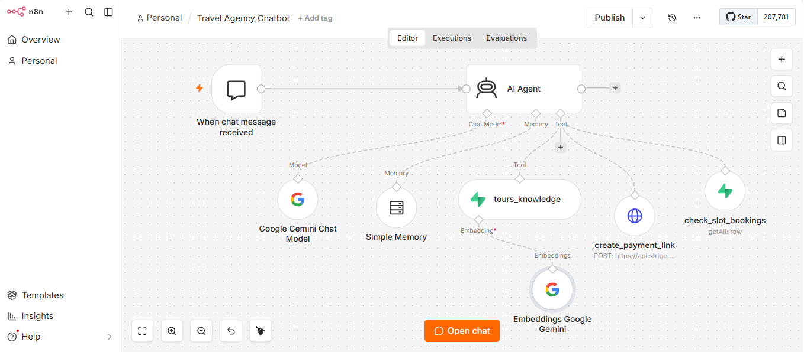

# Travel Agency AI Chatbot

An AI-powered travel agency chatbot built with **n8n**, **Google Gemini**, **Supabase** (RAG) and **Stripe** (test mode). It answers customer questions about tours, collects booking details, takes payment, and sends confirmation emails automatically.

## What It Does

1. **Answers tour questions (RAG):** The chatbot searches a Supabase knowledge base and uses Gemini to give accurate answers about tours.
2. **Collects booking details:** It asks for the customer's name, email, tour and date, then confirms them with the customer.
3. **Creates a Stripe payment link:** The customer pays through a Stripe Checkout link.
4. **Saves the booking:** After payment, the booking is saved in a Supabase table.
5. **Sends confirmation emails:** Both the customer and the owner receive a confirmation email.

## Tech Stack

- **n8n** - workflow automation
- **Google Gemini** - AI model and embeddings
- **Supabase** - vector knowledge base and bookings table
- **Stripe** - payments (test mode)

## How RAG Works Here

RAG means the AI first retrieves relevant data from an external knowledge base, then uses it to generate a better answer. In this project, tour information is stored in Supabase, and the chatbot retrieves the matching information before replying.

## Screenshots

### Main Chatbot Workflow (n8n)

## Note

This project was tested end-to-end in **Stripe Test Mode**. No real payments are processed.

## Author

**Asma Ashraf** - AI Automation Developer
[LinkedIn](https://www.linkedin.com/in/asma-ashraf-9131712bb)
